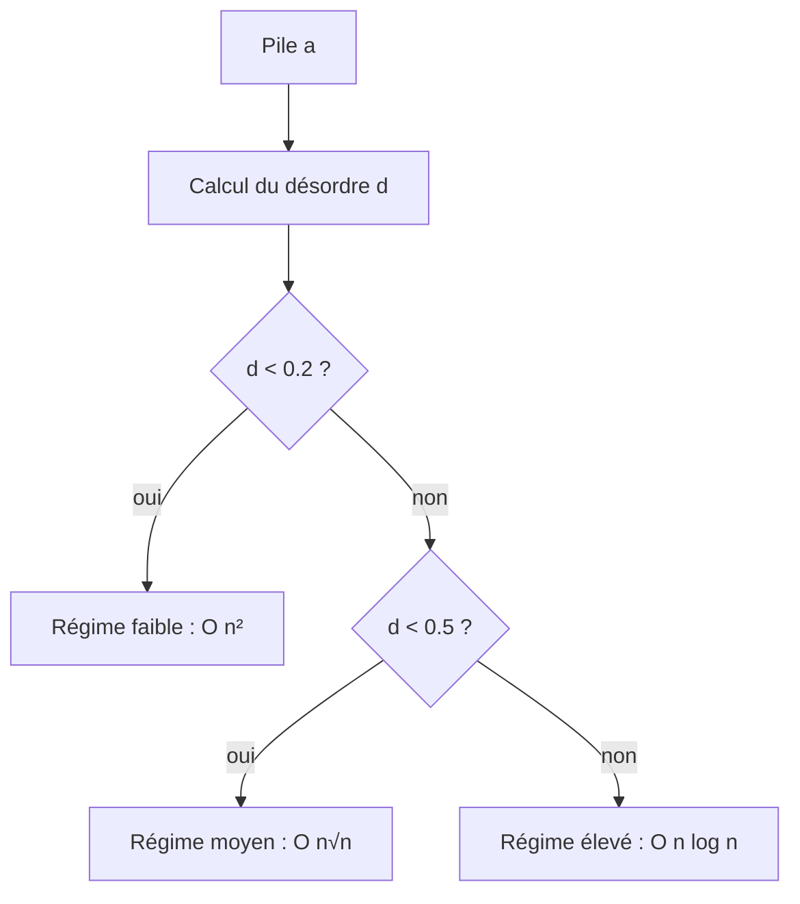

*This project has been created as part of the 42 curriculum by saerramd, waoukoud.*

<div align="center">


</div>

---

## Sommaire

1. [Description](#description)
2. [Instructions](#instructions)
3. [Fonctionnement du programme](#fonctionnement-du-programme)
4. [Algorithmes](#algorithmes)
5. [Mode benchmark](#mode-benchmark)
6. [Gestion des erreurs](#gestion-des-erreurs)
7. [Performances](#performances)
10. [Contributions](#contributions)
11. [Ressources](#ressources)

---

## Description

**Push_swap** est un projet d'algorithmique du tronc commun de 42. Il consiste à trier une pile d'entiers en utilisant **deux piles** (`a` et `b`) et un **jeu d'opérations limité**, en produisant la **plus petite séquence d'opérations possible**.

Le programme `push_swap` reçoit en arguments une liste d'entiers (le premier argument est le sommet de la pile `a`), puis affiche sur la sortie standard, une opération par ligne, un programme en *langage Push_swap* qui trie la pile `a` par ordre croissant, le plus petit nombre au sommet, avec `b` vide à la fin.

> [!IMPORTANT]
> L'enjeu du projet est de découvrir la **complexité algorithmique de manière concrète** : la complexité annoncée pour chaque algorithme est mesurée en **nombre d'opérations Push_swap générées**, et non en complexité théorique d'un algorithme classique sur tableau.

### Présentation

| | |
|:---|:---|
| **Objectif** | Trier la pile `a` avec un nombre minimal d'opérations |
| **Livrable** | Exécutable `push_swap` (et `checker` en bonus) |
| **Fichiers rendus** | `Makefile`, `*.h`, `*.c` |
| **Compétences** | Algorithmique, complexité, piles, listes chaînées, gestion mémoire, parsing, Makefile |
| **Stratégies** | 4 : Simple `O(n²)`, Medium `O(n√n)`, Complex `O(n log n)`, Adaptive |
| **Travail** | Projet réalisé en binôme : `saerramd` et `waoukoud` |

### Les opérations disponibles

| Opération | Effet |
|:---:|:---|
| `sa` / `sb` | Échange les deux premiers éléments de la pile `a` / `b`. Sans effet s'il y a moins de deux éléments. |
| `ss` | `sa` et `sb` en même temps. |
| `pa` | Prend le premier élément de `b` et le place au sommet de `a`. Sans effet si `b` est vide. |
| `pb` | Prend le premier élément de `a` et le place au sommet de `b`. Sans effet si `a` est vide. |
| `ra` / `rb` | Rotation vers le haut : le premier élément devient le dernier. |
| `rr` | `ra` et `rb` en même temps. |
| `rra` / `rrb` | Rotation vers le bas : le dernier élément devient le premier. |
| `rrr` | `rra` et `rrb` en même temps. |

---

## Instructions

### Compilation

Le `Makefile` compile chaque fichier source avec `cc -Wall -Wextra -Werror`, compile d'abord la `libft` présente dans le dossier `libft/` via son propre `Makefile`, puis produit l'exécutable. Il ne relink pas inutilement.

| Commande | Effet |
|:---|:---|
| `make` | l'exécutable `push_swap` |
| `make clean` | Supprime les fichiers objets |
| `make fclean` | Supprime les fichiers objets et les exécutables |
| `make re` | Recompile entièrement le projet |
| `make bonus` | Compile le programme `checker` (partie bonus) |

### Utilisation

```bash
./push_swap [--simple | --medium | --complex | --adaptive] [--bench] <liste d'entiers>
```

| Option | Effet |
|:---|:---|
| `--simple` | Force l'algorithme `O(n²)` |
| `--medium` | Force l'algorithme `O(n√n)` |
| `--complex` | Force l'algorithme `O(n log n)` |
| `--adaptive` | Force l'algorithme adaptatif basé sur le désordre (**comportement par défaut**) |
| `--bench` | Affiche les statistiques de tri sur `stderr` |

Les sélecteurs fonctionnent pour **toute entrée valide**, quelles que soient sa taille et son désordre.

### Exemples

```bash
$> ./push_swap 2 1 3 6 5 8
```

```bash
# Stratégie adaptative par défaut + nombre d'opérations
$> ARG="4 67 3 87 23"; ./push_swap --adaptive $ARG | wc -l

# Forcer une stratégie et vérifier avec le checker
$> ARG="4 67 3 87 23"; ./push_swap --complex $ARG | ./checker_linux $ARG
OK

# Grande entrée
$> shuf -i 0-9999 -n 500 > args.txt ; ./push_swap $(cat args.txt) | wc -l

# Benchmark sur stderr, opérations vers le checker
$> ./push_swap --bench $(cat args.txt) 2> bench.txt | ./checker_linux $(cat args.txt)
OK
```

Sans argument, le programme n'affiche rien et rend la main.

---

## Fonctionnement du programme

1. **Parsing et validation** : conversion des arguments en entiers, détection des erreurs (non-entier, dépassement de `int`, doublon).
2. **Mesure du désordre** : calculée **avant tout mouvement** (voir ci-dessous).
3. **Sélection de la stratégie** : imposée par un sélecteur, ou choisie selon le désordre en mode adaptatif.
4. **Génération des opérations** : chaque opération est appliquée sur les piles et enregistrée.
5. **Affichage** : les opérations sont écrites sur `stdout`, séparées par `\n` et rien d'autre.
6. **Libération de la mémoire** : toute la mémoire allouée est libérée avant la sortie.


### Métrique de désordre

Le désordre est un nombre compris entre `0` (pile déjà triée) et `1` (pile dans l'ordre inverse). Il correspond à la proportion de **paires inversées** parmi toutes les paires possibles :

```
disorder = nombre de paires (i < j) telles que a[i] > a[j]  /  nombre total de paires
```

```
fonction compute_disorder(a):
    mistakes = 0
    total_pairs = 0
    pour i de 0 à taille(a) - 1:
        pour j de i + 1 à taille(a) - 1:
            total_pairs += 1
            si a[i] > a[j]:
                mistakes += 1
    retourner mistakes / total_pairs
```

> [!NOTE]
> Le calcul est en `O(n²)` en temps mais s'effectue **hors du modèle Push_swap** : il ne génère aucune opération et n'influence donc pas le nombre d'opérations affichées.

---

## Algorithmes

Le binaire embarque **quatre stratégies**, toutes sélectionnables à l'exécution. Pour les trois premières, la complexité est exprimée en **nombre d'opérations générées** pour `n` éléments.

| Stratégie | Option | Algorithme | Complexité (opérations) |
|:---|:---|:---|:---:|
| **Simple** | `--simple` | Tri par sélection (extraction successive du minimum) | `O(n²)` |
| **Medium** | `--medium` | Tri par blocs (`√n` chunks) | `O(n√n)` |
| **Complex** | `--complex` | Tri radix LSD en base 2 sur les indices normalisés | `O(n log n)` |
| **Adaptive** | `--adaptive` | Choix de l'algorithme selon le désordre | selon le régime |

<!-- À ADAPTER : si vos algorithmes réels diffèrent de ceux décrits ci-dessous, modifiez cette section pour qu'elle reflète fidèlement votre code. -->

### Étape commune : normalisation

Avant tout tri, chaque valeur est remplacée par son **rang** (de `0` à `n - 1`) dans l'ordre trié. Les algorithmes travaillent sur ces indices : cela simplifie les comparaisons, rend le radix applicable aux nombres négatifs, et ne change pas le résultat final.

### 1. Simple — tri par sélection, `O(n²)`

**Principe** : à chaque itération, on cherche l'élément minimum de `a`, on le fait remonter au sommet par `ra` ou `rra` (le sens le plus court), puis on le pousse dans `b` avec `pb`. Une fois `a` vide, on renvoie tout dans `a` avec `pa` : les éléments reviennent dans l'ordre croissant.

**Justification** : algorithme simple à écrire et à prouver, très efficace sur de petites piles et à faible désordre.

**Argument de complexité** :
- Chaque extraction coûte au plus `n/2` rotations (le sens le plus court est choisi) plus un `pb`.
- Il y a `n` extractions, soit environ `n · n/2 = O(n²)` opérations, auxquelles s'ajoutent `n` `pa`.
- **Temps** : `O(n²)` opérations. **Espace** : `O(n)` pour les deux piles, `O(1)` supplémentaire.

### 2. Medium — tri par blocs, `O(n√n)`

**Principe** : les indices sont répartis en `≈ √n` blocs (chunks) de taille `≈ √n`. On traite les blocs dans l'ordre croissant : les éléments du bloc courant sont poussés dans `b` (en privilégiant le chemin le plus court), les éléments les plus petits du bloc étant relégués vers le bas de `b` par `rb`. Ensuite, on vide `b` vers `a` en remontant à chaque fois le plus grand élément restant au sommet de `b` avant `pa`.

**Justification** : les éléments d'un bloc sont proches dans la pile après le premier passage, ce qui réduit les rotations par rapport à la sélection pure.

**Argument de complexité** :
- Phase de `pb` : chaque élément nécessite en moyenne `O(√n)` rotations, soit `n · O(√n) = O(n√n)`.
- Phase de `pa` : `b` est organisée par blocs, le maximum est à distance `O(√n)` en moyenne, soit `O(n√n)`.
- **Temps** : `O(n√n)` opérations. **Espace** : `O(n)`.

### 3. Complex — radix LSD binaire, `O(n log n)`

**Principe** : on trie les indices bit par bit, du bit de poids faible au bit de poids fort. Pour chaque bit `k` : on parcourt `a` en faisant `pb` si le bit `k` vaut `0`, `ra` sinon ; puis on renvoie tout `b` dans `a` avec `pa`. Après le dernier bit, `a` est triée.

**Justification** : les opérations restent régulières et prévisibles, et le nombre de passes ne dépend que de `n`, pas de la disposition initiale.

**Argument de complexité** :
- Le nombre de passes est `⌈log₂ n⌉` (taille en bits du plus grand indice `n - 1`).
- Chaque passe effectue `n` opérations de tri (`pb` ou `ra`) puis au plus `n` `pa`, soit `O(n)` par passe.
- **Temps** : `O(n log n)` opérations. **Espace** : `O(n)`.

### 4. Adaptive — selon le désordre

**Principe** : la stratégie adaptative mesure le désordre `d` **avant tout mouvement**, puis choisit la méthode adaptée, en respectant les cibles de complexité imposées par le sujet.

| Régime | Condition | Méthode | Complexité cible |
|:---|:---:|:---|:---:|
| **Faible désordre** | `d < 0.2` | Algorithme `O(n²)` (type sélection / insertion) | `O(n²)` |
| **Désordre moyen** | `0.2 ≤ d < 0.5` | Tri par blocs | `O(n√n)` |
| **Désordre élevé** | `d ≥ 0.5` | Radix LSD | `O(n log n)` |




---

## Mode benchmark

Avec `--bench`, le programme affiche **après le tri**, sur `stderr` uniquement, les statistiques suivantes :

- le désordre calculé (en `%`, avec deux décimales) ;
- le nom de la stratégie utilisée et sa complexité théorique ;
- le nombre total d'opérations ;
- le nombre de chaque type d'opération (`sa`, `sb`, `ss`, `pa`, `pb`, `ra`, `rb`, `rr`, `rra`, `rrb`, `rrr`).

La sortie standard (les opérations) reste inchangée et peut être redirigée vers le `checker`.

```bash
$> ARG="4 67 3 87 23"; ./push_swap --bench --adaptive $ARG 2> bench.txt | ./checker_linux $ARG
OK
$> cat bench.txt
[bench] disorder: 40.00%
[bench] strategy: Adaptive / O(n√n)
[bench] total_ops: 13
[bench] sa: 0 sb: 0 ss: 0 pa: 5 pb: 5
[bench] ra: 2 rb: 1 rr: 0 rra: 0 rrb: 0 rrr: 0
```

---

## Gestion des erreurs

En cas d'erreur, le programme affiche `Error` suivi d'un `\n` sur la **sortie d'erreur standard**.

| Cas d'erreur | Exemple |
|:---|:---|
| Argument non entier | `./push_swap 0 one 2 3` |
| Entier hors des limites d'un `int` | `./push_swap 2147483648` |
| Doublon | `./push_swap 3 2 3` |
| Option inconnue ou mal formée | `./push_swap --foo 1 2 3` |

Cas particuliers : sans argument, rien n'est affiché ; si la pile est déjà triée, aucune opération n'est affichée.

---

## Performances

Objectifs du sujet, vérifiés à l'évaluation avec le `Benchmark` fourni :

| Taille de l'entrée | Pour valider | Bon | Excellent |
|:---:|:---:|:---:|:---:|
| **100 nombres** | < 2000 | < 1500 | < 700 |
| **500 nombres** | < 12000 | < 8000 | < 5500 |


## Contributions

Le projet a été réalisé en binôme. Les deux membres comprennent et peuvent expliquer l'intégralité du code.

<!-- À COMPLÉTER : décrivez la répartition réelle du travail. -->

| Membre | Login | Contributions |
|:---|:---:|:---|
| Membre 1 | `saerramd` | Benchmark,Checker, gestion des instructions, tests et validation du résultat |
| Membre 2 | `waoukoud` | Parsing, gestion des erreurs, opérations sur les stacks, algorithmes de tri |

---

## Ressources

### Références

- Sujet officiel du projet **Push_swap**, version 1.2.
- [Notation Big-O et analyse de complexité](https://en.wikipedia.org/wiki/Big_O_notation)
- [Tri par sélection](https://en.wikipedia.org/wiki/Selection_sort)
- [Tri radix](https://en.wikipedia.org/wiki/Radix_sort)
- [Structure de données pile](https://en.wikipedia.org/wiki/Stack_(abstract_data_type))
- [Documentation de GNU Make](https://www.gnu.org/software/make/manual/)
- Norme de 42.

### Utilisation de l'IA

<!-- À ADAPTER : indiquez précisément les tâches et les parties du projet concernées. -->

L'IA a été utilisée comme outil d'appui pour la **documentation** : rédaction et mise en forme de ce README. Le code du projet (parsing, opérations, algorithmes, `Makefile`) a été écrit, testé et compris par `saerramd` et `waoukoud`, qui sont en mesure de l'expliquer et de le défendre.

<div align="center">


</div>